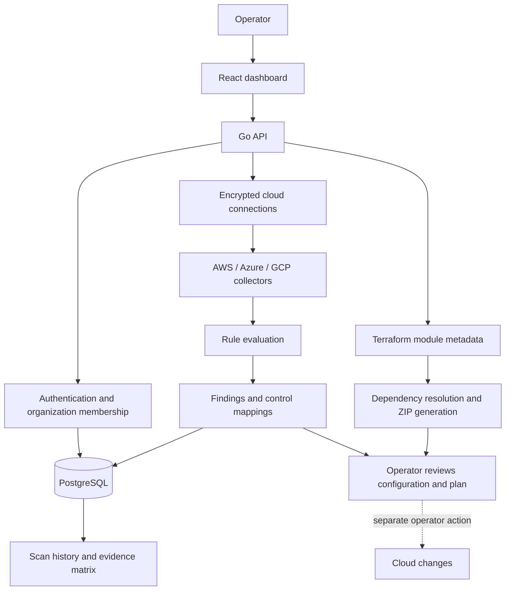

# Design and coverage

This document describes the implementation present in this repository. See [README.md](README.md) for setup and publication status. Examples below are illustrative, not captured production results.

## Architecture



### Organization boundaries

Authenticated routes use organization membership checks; connections, scans and findings carry organization context. This makes shared application workflows possible without keeping a separate deployment per organization. Membership checks and application queries are the boundary: this is not a claim of independently verified tenant isolation. Review every new endpoint for organization scope and role enforcement.

### Credentials and key management

Connection credentials use envelope encryption: a data encryption key protects the credential payload, and a local key or AWS KMS wraps that key. Cloud credentials remain sensitive even when encrypted at rest; the API must decrypt them to collect configuration.

The API entry point validates explicit signing and encryption configuration before connecting to PostgreSQL. There is no fallback JWT secret or fallback encryption master key. Local encryption and JWT signing require different secrets. With `ENCRYPTION_KEK_ID`, AWS KMS takes precedence over the local encryption key; the API runtime needs separately configured permission to use that KMS key.

Store the encryption key durably and separately from database backups. Changing it does not re-encrypt stored connections. Existing installations using the former development key need a deliberate migration or credential re-enrollment; replacing the key blindly makes existing encrypted records unreadable.

### Analysis and changes

Collectors retrieve configuration, rules produce findings, and the generator assembles Terraform bundles. Generated output does not constitute approval to change infrastructure. The operator must review ownership, dependencies, current state and a plan before applying any change.

Project IAM removal and service-account/access-key retirement return manual guidance without executable configuration or commands. A resource declaration that grants access or creates a key cannot express removal of an unidentified existing binding or key.

### Metadata-driven catalog

Each module carries variables, control mappings and dependency metadata. The generator uses these declarations to assemble bundles and wire dependencies. This keeps catalog composition close to the Terraform modules while making mapping decisions visible to reviewers.

## Cloud coverage

The counts below describe registered check functions in source, not a percentage of cloud or SOC 2 coverage. One function can emit multiple finding types. Availability of a check does not prove that its collector observed every relevant resource.

| Cloud | Registered checks | Resource and configuration areas | Terraform catalog |
| --- | ---: | --- | --- |
| GCP | 35 | Storage access, versioning, encryption and retention; Cloud SQL security and resilience; Compute, firewall and subnet settings; project IAM, service-account keys, logging sinks, KMS and Secret Manager; Cloud Asset Inventory checks for BigQuery, Cloud Run, Pub/Sub and instance templates | Storage bucket, KMS key, PostgreSQL Cloud SQL |
| AWS | 14 | S3 public access, policies, versioning and encryption; RDS encryption, deletion protection, Multi-AZ, backups and exposure; EC2 public IPs, security-group ingress, KMS rotation, IAM access keys and CloudTrail configuration | S3 bucket, KMS key, PostgreSQL RDS |
| Azure | 11 | Storage public access, TLS and infrastructure encryption; PostgreSQL Flexible Server network exposure, HA, backups and deletion protection; Key Vault soft delete and network exposure; VM public IPs and broad NSG ingress | Storage account, Key Vault, PostgreSQL Flexible Server |

Source: [`checks.go`](api/internal/analysis/checks.go), [`checks3.go`](api/internal/analysis/checks3.go), [`aws_checks.go`](api/internal/analysis/aws_checks.go), [`azure_checks.go`](api/internal/analysis/azure_checks.go). Connector permissions and setup templates are under [`templates/connectors`](templates/connectors).

The nine catalog modules and the scan checks serve different purposes. The presence of a module does not establish detection coverage; a detection does not imply a complete, safe remediation module.

## Example: review a bucket access finding

This is a worked example with fictional names. It explains the workflow without claiming a successful cloud scan or deployment.

1. **Resource:** a GCP bucket called `example-platform-artifacts` is collected with uniform bucket-level access disabled.
2. **Finding:** `storage_bucket_uniform_access`, severity `high`. The check records the project and location and associates the observation with `CC6.1` and `CC6.6` through project-authored mappings.
3. **Interpretation:** access can depend on object ACLs as well as IAM. Review consumers and permissions before changing this behavior. This finding alone does not say the bucket is public; that is a separate check.
4. **Terraform proposal:** locate the existing bucket configuration and propose a narrow change within that resource:

   ```hcl
   # Fragment to merge into the EXISTING google_storage_bucket resource.
   # Keep its name, location, lifecycle and other settings unchanged.
   uniform_bucket_level_access = true
   ```

   The application's generic bucket snippet also contains example settings for other concerns. It is a draft, not the narrow patch above. Do not replace an existing resource with it wholesale. If the bucket is unmanaged, establish ownership and a correct import identity first.

5. **Review:** confirm required identities have IAM access, examine ACL-dependent consumers, review the full plan for replacement or unrelated changes, and obtain the environment owner's approval. Apply through the team's normal infrastructure delivery process.
6. **Evidence:** after an approved change, collect a fresh observation and retain the plan, change record and relevant review evidence. A later scan result would describe that observation; this document does not assert one has been run.

## Limits that matter

- No tests, builds, cloud scans or deployments were executed for this publication or documentation update. Existing test sources and scripts are not evidence of passing results.
- Remaining remediation snippets are illustrative drafts. Some contain placeholder names, broad defaults or provider-schema assumptions. They need review and further correction before operational use. In particular, adding a private IAM grant does not remove an existing public grant.
- A completed scan or no findings does not prove complete inventory or effective controls. Missing permissions, unavailable APIs and unsupported resources can leave gaps.
- The evidence matrix summarizes stored observations. It does not establish effectiveness over an audit period, and must not be interpreted as a compliance percentage.
- Control mappings are project-authored interpretations, not an authoritative SOC 2 edition or an attestation. Organizational policies, people and operating evidence remain outside this tool's infrastructure scope.
- Docker Compose credentials and the unencrypted local database connection are development conveniences. Production deployment, key rotation, tenant isolation and operational security require further review.

## Review tooling

Go test sources, frontend build configuration and `scripts/validate-templates.sh` are included for future validation. The GitHub Actions workflow uses manual dispatch only. Publishing changes does not trigger those checks automatically.
